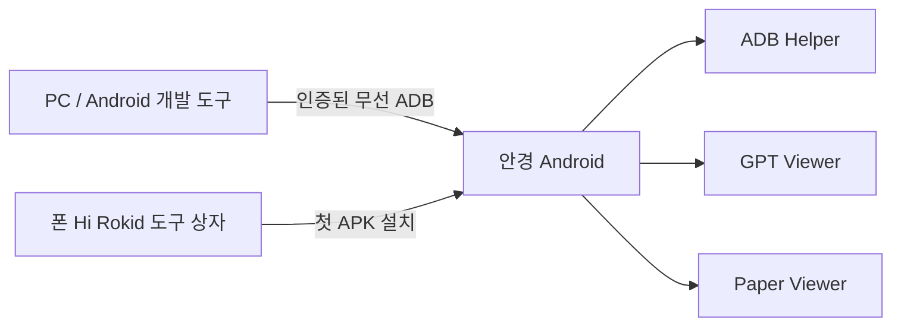

# 전체 구조

안경 하드웨어 위에 YodaOS-Sprite / Android가 실행되고, 이 저장소의 APK는 그 위에서 독립 앱으로 실행됩니다. Hi Rokid 도구 상자는 APK 설치 수단이며, ADB는 PC 개발 도구와 안경을 연결합니다.

현재 세 앱은 Java와 Android 기본 API를 사용합니다. UI/파일 선택/시스템 설정 호출은 Android 계층에 두고, 향후 의미 있는 영상 전처리·상태 머신·버퍼 처리 등을 C로 분리해 NDK/JNI로 연결할 수 있습니다. Python은 PC 모델 실험·분석·테스트에 활용할 수 있습니다. 현재 C 구현은 없습니다.

Rokid가 Bare Metal이라고 부르는 독립 앱 경로도 Android 위의 사용자 공간 앱입니다. MCU 펌웨어, 커널/드라이버, 레지스터 또는 NPU 직접 접근을 보장하지 않습니다.

폰 연동이 필요해지면 공개 CXR-L을 검토합니다. CXR-L은 폰 앱에 넣어 Hi Rokid를 통해 지원되는 안경 기능을 사용하는 라이브러리이며 현재 APK의 필수 요소가 아닙니다. 폰 앱·세션·Custom View·Custom App 계약을 확인한 후 별도 구현합니다. 현재 폰 companion, 서버, API 답변 전달·완료 알림은 없습니다.

공식 경로: [Rokid SDK 개요](https://developerdoc.rokid.com/sdk?lang=en), [Android NDK](https://developer.android.com/ndk/guides).
