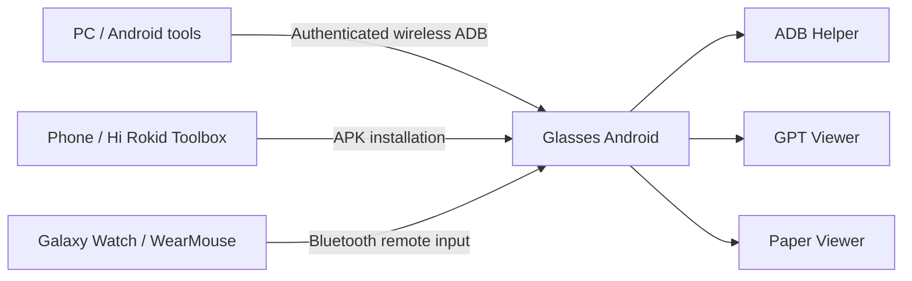

# Architecture

English | [한국어](ARCHITECTURE.ko.md)

YodaOS-Sprite / Android runs on the glasses hardware. Each APK in this repository runs as a standalone Android app. Hi Rokid Toolbox installs the first APK; ADB connects PC development tools to the glasses.

Current apps use Java and Android APIs. UI, file selection and settings actions belong at the Android boundary. Future processing may use portable C through NDK/JNI for image preprocessing, state machines or bounded buffers, with Python for PC experiments and analysis. No C processing is implemented yet.

Rokid's Bare Metal path is an Android userspace app path. It does not imply MCU firmware, kernel/driver changes, register access or direct NPU control.

AnExplorer is optional external tooling. Its storage permissions and licensing are separate from our APKs. The PDF viewer currently copies a selected document privately before rendering; direct-original access is planned. See [apps](APPS.md) and [file transfer](FILE_TRANSFER.md).

Phone integration may later use public CXR-L. It is a library for a phone app to use supported glasses capabilities through Hi Rokid, not a required part of the current glasses APKs. Verify the phone authorization/session/Custom View/Custom App contracts before implementation. There is no companion app, server, API answer delivery or completion notification now.

Existing ChatGPT app conversations and responses requested through an OpenAI API application are separate. Current prototypes do not read ChatGPT history or its completion events.

Official references: [Rokid SDK overview](https://developerdoc.rokid.com/sdk?lang=en), [Android NDK](https://developer.android.com/ndk/guides).
